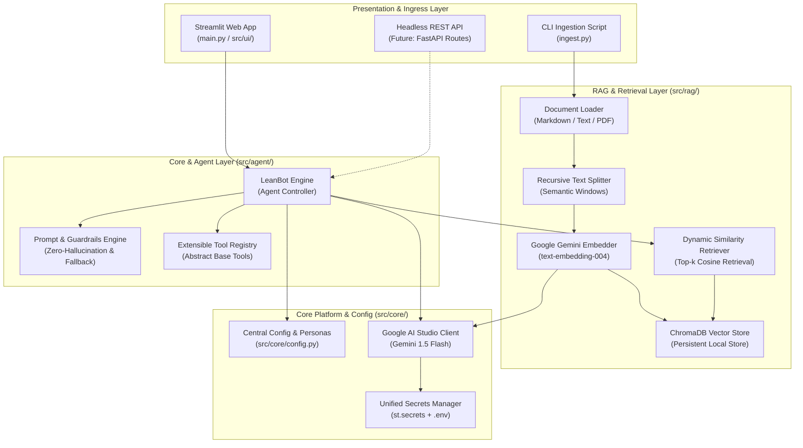
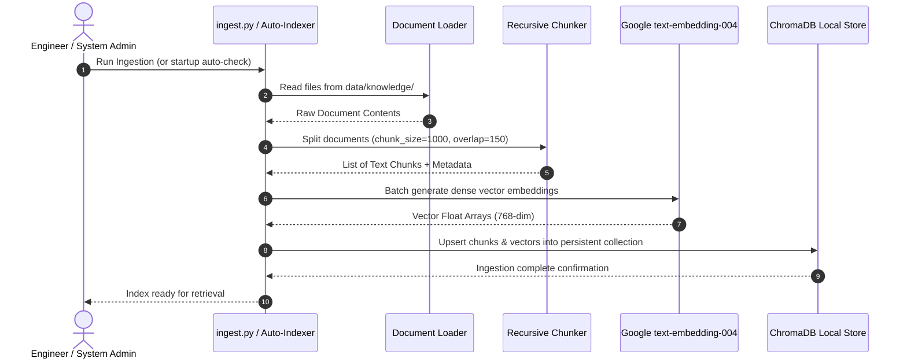
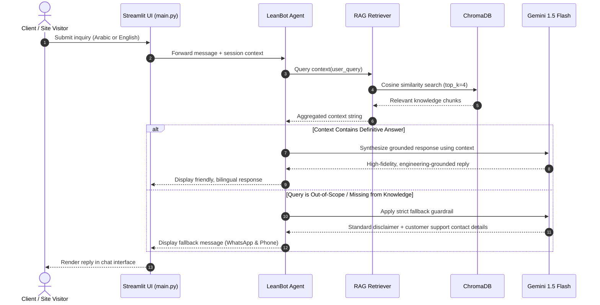

# EngrLean Smart RAG Agent — Technical Architecture Document

## 1. Executive Summary & Corporate Profile

**EngrLean** is a forward-thinking engineering and technology consultancy firm committed to delivering high-impact solutions across the digital, physical, and infrastructural domains.

* **Company Name:** EngrLean
* **Official Website:** [https://engrlean.com/](https://engrlean.com/)
* **Chief Executive Officer:** Eng. Mohamed Yahia
* **Corporate Taglines:** 
  * *"Built on engineering. Driven by technology."*
  * *"Engineering meets Technology."*
* **Core Business Pillars:**
  1. **Digital Transformation:** Enterprise IT consulting, governance, compliance frameworks, business process optimization, and cybersecurity advisory.
  2. **Software & Integration:** Tailored enterprise software development, ERP/CRM integrations, API architectures, connected business platforms, and automated workflow orchestrations.
  3. **ICT & Smart Systems:** Telecommunications infrastructure, physical/virtual data center designs, smart building technologies, and emerging building automation/smart home ecosystems.

### Project Vision
The **EngrLean Smart RAG Agent (`LeanBot`)** is designed as a cost-efficient, production-grade, API-first Retrieval-Augmented Generation (RAG) and conversational agent system. Built to serve website visitors, qualify business leads, and provide accurate engineering intelligence, the architecture enforces:
* **Zero Vendor Lock-in:** Modular interfaces abstract LLM providers, vector databases, and presentation clients.
* **Cost Efficiency:** Powered by Google's high-context, ultra-low-latency Gemini 1.5 Flash and `text-embedding-004` (operating seamlessly within the free/low-cost tier).
* **Cross-Lingual Native Fluency:** Seamless cross-lingual understanding across English and Arabic inquiries.
* **Strict Guardrails:** Zero-hallucination operational boundaries with automated redirection to corporate communication channels for out-of-scope inquiries.
* **Dual-Target Deployment:** Root-level orchestrator (`main.py`) compatible with one-click Streamlit Community Cloud hosting, while cleanly isolating the core business logic for immediate transition to headless FastAPI endpoints.

---

## 2. High-Level Architectural Paradigm

The solution adopts a **Layered Clean Architecture** adhering to SOLID principles. The codebase strictly avoids monolithic scripting or Jupyter Notebooks in production paths.



---

## 3. Component Deep Dive

### 3.1. Core Platform & Configuration (`src/core/`)
* **`config.py`**: Central source of truth for application settings:
  * Agent metadata (`name="LeanBot"`, `role="EngrLean AI Engineering Consultant"`).
  * Brand contact fallbacks (`support_email="contact@engrlean.com"`, `whatsapp_phone="+20 100 000 0000"`).
  * RAG tuning parameters (`chunk_size=1000`, `chunk_overlap=150`, `top_k=4`).
  * Model identifiers (`gemini-1.5-flash`, `text-embedding-004`).
* **`secrets.py`**: Robust, dual-source credential resolver:
  * Prioritizes Streamlit Secrets (`st.secrets["GEMINI_API_KEY"]`) when executed inside Streamlit Cloud.
  * Gracefully falls back to local `.env` variables via `python-dotenv` during local development or headless CLI execution.
* **`llm.py`**: Unified SDK client factory wrapping `google-generativeai`. Implements retry logic, backoff, and model temperature controls.

### 3.2. RAG & Retrieval Engine (`src/rag/`)
* **`loader.py`**: Scans the designated knowledge directory (`data/knowledge/`) for raw corporate intelligence documents (Markdown, Plain Text).
* **`chunker.py`**: Implements recursive character-level text splitting with configurable chunk sizing and overlap to preserve technical context across boundary splits.
* **`vectorstore.py`**: Encapsulates ChromaDB persistent storage. Handles collection initialization, embedding generation via Google API, and similarity queries.
* **`pipeline.py`**: High-level retrieval orchestrator providing auto-bootstrapping:
  * Checks if ChromaDB index exists on disk.
  * If missing (e.g., initial boot on Streamlit Cloud), triggers autonomous indexing without user intervention.
  * Exposes clean query interface: `query_context(user_query: str) -> List[Document]`.

### 3.3. Conversational Agent Core (`src/agent/`)
* **`bot.py` (`LeanBot`)**: Orchestrates the multi-turn conversational loop, user queries, context augmentation, and response generation.
* **`prompts.py`**: Houses meticulously engineered prompt templates:
  * **System Persona:** Professional, friendly, engineering-grounded tone representing EngrLean.
  * **Strict Grounding:** Restricts answers strictly to retrieved context.
  * **Fallback Handling:** Instructs the model to output a polite disclaimer and provide phone/WhatsApp/email contact details when answers cannot be substantiated by the knowledge base.
* **`tools/base.py`**: Abstract foundation (`AbstractTool`) providing standard signatures for future execution tools (e.g., Gmail notifications, lead capture webhooks, CRM sync).

### 3.4. User Interface & Branding (`src/ui/` & `main.py`)
* **`main.py`**: Root-level entrypoint designed specifically to satisfy Streamlit Community Cloud requirements without path resolution errors. Bootstraps the application and delegates to `src/ui/app.py`.
* **`src/ui/styles.py`**: Custom CSS injections adhering to EngrLean's brand palette:
  * **Dark Charcoal:** `#1E222A` (Background & deep structural framing)
  * **Slate / Industrial Blue:** `#2B3E50` (Containers & headers)
  * **Engineering Cyan Accent:** `#00ADB5` / `#00D2DF` (Action items, highlights & buttons)
  * **Clean Light Neutral:** `#F9FAFB` / `#E5E7EB` (Readable typography)
* **`src/ui/app.py`**: Streamlit session state management, chat transcript rendering, and one-click database re-index trigger.

---

## 4. End-to-End Data Flow

### 4.1. Knowledge Ingestion Flow



### 4.2. Conversational Inference & Guardrail Flow



---

## 5. Directory Structure

```text
EngrLean-smart-rag-agent/
├── .env.example                # Sample environment variables
├── .gitignore                  # Git exclusions (credentials, chroma_db, caches)
├── ARCHITECTURE.md             # Exhaustive system architecture specification
├── FUTURE_WORK.md              # Roadmap for tools, database backends, hybrid search
├── README.md                   # Complete deployment & operations guide
├── requirements.txt            # Python dependencies (pinned for stability)
├── main.py                     # Root entrypoint for Streamlit Community Cloud
├── ingest.py                   # Standalone CLI knowledge base ingestion script
├── data/
│   └── knowledge/              # Knowledge repository
│       └── engrlean_profile.md # Structured corporate profile & services catalog
└── src/
    ├── __init__.py
    ├── core/
    │   ├── __init__.py
    │   ├── config.py           # Centralized configuration & brand variables
    │   ├── secrets.py          # Dual loader (st.secrets + .env)
    │   └── llm.py              # Google AI Studio API wrapper
    ├── rag/
    │   ├── __init__.py
    │   ├── loader.py           # Document ingestion from filesystem
    │   ├── chunker.py          # Recursive text splitter logic
    │   ├── vectorstore.py      # ChromaDB interface & management
    │   └── pipeline.py         # End-to-end RAG orchestrator & retriever
    ├── agent/
    │   ├── __init__.py
    │   ├── bot.py              # LeanBot agent logic & conversation loop
    │   ├── prompts.py          # System prompts, guardrails, fallback instructions
    │   └── tools/              # Extensible tools interface (for future hooks)
    │       ├── __init__.py
    │       └── base.py         # AbstractBaseTool definition
    └── ui/
        ├── __init__.py
        ├── styles.py           # EngrLean branded CSS styling
        └── app.py              # Streamlit presentation components
```

---

## 6. Error Handling & Operational Guardrails

1. **Missing / Invalid API Key:**
   * The `secrets.py` module verifies `GEMINI_API_KEY` presence during bootstrap.
   * If missing, displays an intuitive, actionable error message directing the administrator to add the key via `.env` or Streamlit Cloud Secrets.
2. **Missing ChromaDB Storage:**
   * Handled by the auto-bootstrapping sequence in `src/rag/pipeline.py`. If no vector database is detected, it reads `data/knowledge/` and constructs the database automatically without crashing.
3. **Out-of-Scope / Hallucination Prevention:**
   * Handled at the system prompt layer. LeanBot is explicitly forbidden from generating speculative engineering advice, pricing assumptions, or unverified claims.
   * If similarity score confidence is insufficient or the context does not address the inquiry, the fallback response is triggered.
4. **Rate Limits & API Resilience:**
   * Wrapped API calls utilize standard exponential retry backoffs to protect against transient 429 / 503 HTTP status codes from Google AI Studio.

---

## 7. Extensibility & Future-Proofing

The architecture is deliberately partitioned to enable zero-refactoring upgrades:
* **Tool Extensibility:** New capabilities (e.g., `SendEmailNotificationTool`, `WhatsAppWebhookTool`) will inherit from `AbstractTool` in `src/agent/tools/base.py` and register with `LeanBot` dynamically.
* **Headless API Transition:** When transitioning from Streamlit to a standalone web frontend, `main.py` can be paired with or swapped for a FastAPI application (`api/main.py`) that consumes `LeanBot` directly as a service.
* **Vector Store Migration:** The vector store interface abstracts ChromaDB, permitting instant migration to Qdrant, Pinecone, or pgvector by subclassing the vector store interface.

